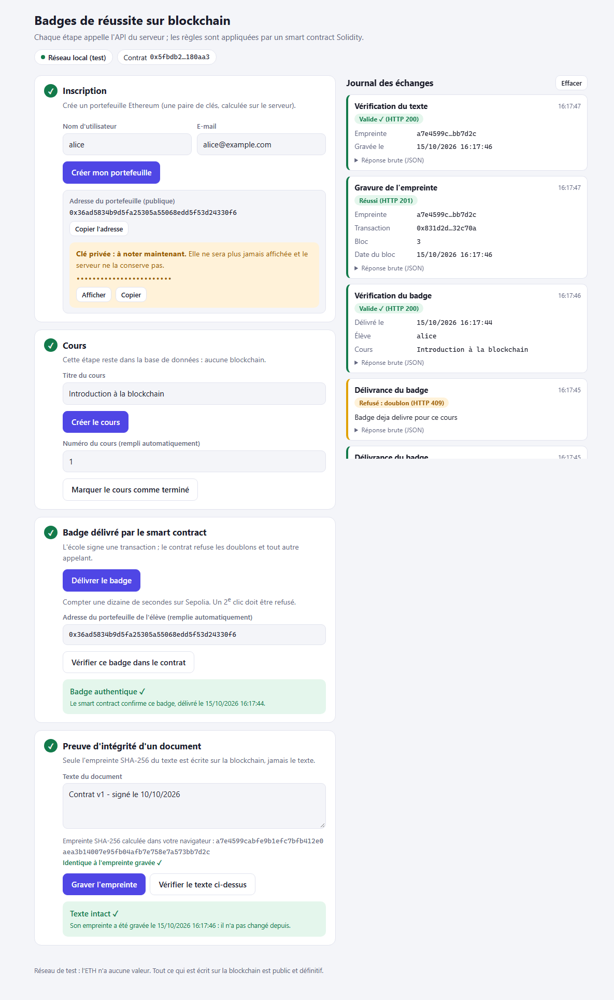

# Badges blockchain : smart contract Solidity sur Ethereum (version Java)

Projet académique Blockchain (4ALINFO1). Une API **Java / Spring Boot** qui s'appuie sur un **smart contract Solidity** déployé sur **Ethereum Sepolia** (réseau de test) pour deux choses :

1. **Badges de réussite** : quand un utilisateur termine un cours, le contrat enregistre son badge. N'importe qui peut vérifier publiquement qu'il existe.
2. **Preuve d'intégrité d'un document** : on grave dans le contrat l'**empreinte SHA-256** d'un texte. Plus tard, on peut prouver que le texte n'a pas changé et qu'il existait à une date donnée.

> Historique : le projet a d'abord été écrit pour Hedera, puis converti à Ethereum. Il s'appelait alors `hedera-badges-java`. Sa base de données s'appelle désormais `blockchain_badges`.

Les **règles** sont dans le contrat (donc sur la blockchain), pas dans le serveur Java :

| Règle | Appliquée par |
|---|---|
| Seule l'école peut délivrer un badge ou graver une empreinte (`onlyOwner`) | **Le contrat** |
| Un seul badge par élève et par cours | **Le contrat** |
| Une empreinte ne se grave qu'une fois (la date d'origine est conservée) | **Le contrat** |
| Un badge n'est délivré que si le cours est terminé | Le serveur (la progression est dans la base SQL) |

Base de données : **PostgreSQL ou MySQL**, au choix, sans modifier le code.

## Architecture

```
 Navigateur : application Angular (frontend/, servie par Spring Boot)
        │  HTTP / JSON
        ▼
 Controllers (web/)           reçoivent les requêtes, valident, formatent le JSON
        ▼
 Services (service/)          logique métier : inscription, cours, badges, preuves
        │                            │
        ▼                            ▼
 Repositories (JPA)           EthereumService (blockchain/)
        │                            │  web3j : transaction signée (écriture) ou eth_call (lecture)
        ▼                            ▼
 PostgreSQL / MySQL           Ethereum Sepolia
 (utilisateurs, cours,        └─ BadgeRegistry.sol (smart contract)
  trace des badges)                 ├─ badges : issueBadge / hasBadge / badgeIssuedAt / badgeCount
                                    └─ preuves : anchorDocument / verifyDocument
```

Deux façons de parler au contrat :

| Type | Exemples | Signature | Coût | Comment |
|---|---|---|---|---|
| **Transaction** (écriture) | `issueBadge`, `anchorDocument` | Oui, clé privée de l'école | ETH de test | Incluse dans un bloc (une dizaine de secondes) |
| **Lecture** (`eth_call`) | `badgeIssuedAt`, `verifyDocument` | Non | Aucun | Réponse immédiate, rien n'est écrit |

Avant chaque écriture, `EthereumService` **simule** l'appel (`eth_call`) : si le contrat doit refuser, on obtient le message du `require()` sans payer de frais.

| Donnée | Où elle est |
|---|---|
| Qui a quel badge, et à quelle date | Contrat (public, infalsifiable) |
| Empreinte d'un document et sa date | Contrat (public, infalsifiable) |
| Utilisateurs, cours terminés, lien badge ↔ transaction | Base SQL |
| Texte du document | **Nulle part** : seul son hash est envoyé |
| Clé privée de l'utilisateur | **Nulle part** : affichée une seule fois à l'inscription |
| Clé privée de l'école | Fichier `.env` du serveur |

## Structure

```
badges-blockchain/
├── pom.xml                                  dépendances Maven (Spring Boot, web3j)
├── .env.example                             modèle de configuration
├── solidity/                                ── LE SMART CONTRACT ──
│   ├── contracts/BadgeRegistry.sol          le contrat
│   ├── test/BadgeRegistry.test.js           12 tests du contrat (Hardhat)
│   ├── scripts/export.js                    copie bytecode + ABI vers le projet Java
│   ├── hardhat.config.js, package.json
├── frontend/                                ── L'INTERFACE WEB (Angular 19) ──
│   ├── src/app/                             composants (4 étapes, journal), services (API, journal, état)
│   ├── src/app/*.spec.ts                    16 tests (Karma / Jasmine)
│   ├── angular.json, proxy.conf.json        build vers src/main/resources/static ; proxy /api en développement
├── src/main/resources/
│   ├── contracts/BadgeRegistry.bin|.abi.json   contrat compilé (généré par "npm run export")
│   ├── application.properties               configuration (base, Ethereum)
│   └── static/                              interface compilée (générée par "npm run build" dans frontend/)
├── src/main/java/com/esprit/badges/
│   ├── BadgesApplication.java               point d'entrée Spring Boot
│   ├── SetupMain.java                       déploie le contrat (une seule fois)
│   ├── DatabaseInitializer.java             crée la base si elle n'existe pas (avant le démarrage de Spring)
│   ├── blockchain/EthereumService.java      TOUT ce qui parle à Ethereum
│   ├── blockchain/EthereumProperties.java   réglages Ethereum lus dans le .env
│   ├── blockchain/ContractRevertException   le contrat a refusé l'opération
│   ├── model/                               entités JPA : User, Course, Badge
│   ├── repository/                          accès à la base (Spring Data JPA)
│   ├── service/                             logique métier
│   └── web/                                 contrôleurs REST + gestion d'erreurs
└── src/test/                                tests Java (Ethereum simulé ; un test sur nœud local)
```

## Installation

Prérequis : **JDK 17+**, **Maven 3.9+**, PostgreSQL **ou** MySQL, et **Node.js 20.11+ ou 22** (uniquement pour modifier ou tester le contrat ou l'interface : l'interface compilée est déjà dans le projet).

1. **Portefeuille de test (l'école)** : créez un compte **MetaMask neuf, réservé aux tests**, et exportez sa clé privée (*Détails du compte → Exporter la clé privée*). **Ne mettez jamais la clé d'un portefeuille qui contient de vrais fonds.**
2. **ETH de test** : récupérez de l'ETH Sepolia gratuit sur un *faucet* (cherchez « Sepolia faucet » ; plusieurs existent, par exemple ceux d'Alchemy, de Google Cloud ou de Chainlink, et ils changent souvent). Quelques centièmes d'ETH suffisent.
3. **Base de données** : elle est **créée automatiquement au démarrage** si elle n'existe pas (`DB_AUTO_CREATE=true` dans `.env`, valeur par défaut). Cela demande que le compte `DB_USER` ait le droit de créer une base : PostgreSQL `ALTER ROLE votre_compte CREATEDB;` (à lancer une fois avec le compte `postgres`). Sinon, ou avec `DB_AUTO_CREATE=false`, créez une base vide à la main (les tables sont créées au démarrage) :
   - PostgreSQL : `CREATE DATABASE blockchain_badges;`
   - MySQL : `CREATE DATABASE blockchain_badges CHARACTER SET utf8mb4;`
   - Si vous aviez déjà lancé l'ancienne version (Hedera), **supprimez cette base et recréez-la vide** : les colonnes ont changé.
4. **Configuration** :
   ```bash
   cp .env.example .env      # Windows PowerShell : copy .env.example .env
   ```
   Renseignez `ETH_PRIVATE_KEY`, `DB_URL`, `DB_USER`, `DB_PASSWORD`. Par défaut, le réseau est atteint par un nœud public gratuit ; pour plus de fiabilité, créez une clé gratuite chez Infura ou Alchemy et mettez son URL dans `ETH_RPC_URL`.
5. **Déployer le contrat (une seule fois)** : n'a pas besoin de la base.
   ```bash
   mvn compile exec:java
   ```
   Le programme affiche l'adresse du portefeuille, son solde, puis `CONTRACT_ADDRESS=0x...`. Copiez cette ligne dans `.env`.
6. **Démarrer** :
   ```bash
   mvn spring-boot:run
   ```
   Ouvrez <http://localhost:3000>.

> Utilisez bien `mvn …` : Maven emploie le JDK de `JAVA_HOME`. Si `java -version` indique moins de 17, corrigez `JAVA_HOME`.

### Modifier le contrat (facultatif)

Le contrat compilé est déjà dans `src/main/resources/contracts/`. Si vous changez `BadgeRegistry.sol` :

```bash
cd solidity
npm install          # une seule fois
npm test             # 12 tests du contrat sur une blockchain locale simulée
npm run export       # recompile et recopie bytecode + ABI dans le projet Java
```

Il faut ensuite **redéployer** (`mvn compile exec:java`) : un contrat déployé ne peut pas être modifié, il en naît un nouveau avec une nouvelle adresse.

### Modifier l'interface (facultatif)

L'interface est une application **Angular 19** (composants autonomes, signaux, sans bibliothèque externe). Spring Boot la sert : l'interface compilée est déjà dans `src/main/resources/static/`, donc `mvn spring-boot:run` suffit pour l'utiliser.

```bash
cd frontend
npm install          # une seule fois
npm test             # 16 tests (Karma / Jasmine, nécessite Chrome ou Edge)
npm run build        # compile l'interface directement dans src/main/resources/static/
npm start            # développement avec rechargement : http://localhost:4200 (l'API Spring doit tourner sur le port 3000)
```

Après un `npm run build`, relancez `mvn spring-boot:run` (ou `mvn process-resources`) pour que Spring serve la nouvelle version. `npm run build` **remplace tout** le contenu de `static/` : n'y mettez pas de fichier à la main.

Fonctionnement : trois services (`ApiService` pour les appels HTTP, `JournalService` pour le journal des échanges, `SessionService` pour l'état partagé entre les étapes) et quatre composants d'étape (inscription, cours, badge, preuve). Le navigateur ne parle **jamais** à la blockchain : il appelle l'API, et c'est le serveur Java qui signe.



### Choisir PostgreSQL ou MySQL

Les deux pilotes sont inclus. Seul `DB_URL` change dans `.env` :

| Base | DB_URL |
|---|---|
| PostgreSQL | `jdbc:postgresql://localhost:5432/blockchain_badges` |
| MySQL | `jdbc:mysql://localhost:3306/blockchain_badges` |

## Scénario de démonstration

Sur la page, dans l'ordre :

1. **S'inscrire** : un portefeuille Ethereum est créé. Notez la clé privée affichée.
2. **Créer le cours**, puis le **marquer comme terminé**.
3. **Délivrer le badge** : une transaction est envoyée au contrat (attendre une dizaine de secondes). Ouvrez le lien Etherscan : la transaction et l'événement `BadgeIssued` y sont visibles.
4. **Cliquer une 2e fois** sur « Délivrer le badge » : réponse `409`. Même si vous supprimez la ligne dans la table `badges`, le serveur lit d'abord le contrat (lecture gratuite) et répond `409` : « Ce badge existe déjà sur la blockchain ». Pour voir le **contrat** refuser lui-même, arrêtez le serveur, mettez dans `.env` la clé d'**un autre portefeuille** (pas celui du déploiement), relancez et délivrez le badge d'**un autre cours** (créez-le et marquez-le terminé) : réponse `422` avec le message du `require()` (« Seule l'ecole peut effectuer cette action »). Remettez ensuite la bonne clé.
5. **Vérifier le badge** : `valid: true`, lu directement dans le contrat à partir de l'adresse du portefeuille.
6. **Graver l'empreinte** d'un texte, puis **vérifier**. Modifiez une lettre et revérifiez : `valid: false`.

## API

| Méthode | URL | Rôle |
|---|---|---|
| POST | `/api/users/register` | Crée l'utilisateur et son portefeuille (`{username, email}`) |
| GET | `/api/users/{email}` | Profil, cours terminés, badges |
| GET / POST | `/api/courses` | Liste / crée un cours (`{title, description, difficulty?}`) |
| POST | `/api/courses/{id}/complete` | Marque le cours terminé (`{email}`) |
| POST | `/api/badges/issue` | Le contrat délivre le badge (`{email, courseId}`) |
| GET | `/api/badges/user/{email}` | Badges d'un utilisateur |
| GET | `/api/badges/verify/{walletAddress}/{courseId}` | Vérifie un badge dans le contrat (public) |
| POST | `/api/proofs` | Grave l'empreinte d'un texte (`{content}`) |
| POST | `/api/proofs/verify` | Compare un texte aux empreintes gravées (`{content}`) |

Codes de réponse à connaître : `409` doublon détecté par le serveur, `422` **refus du smart contract**, `502` blockchain injoignable ou erreur de transaction.

## Tests automatisés : quatre niveaux

| Niveau | Commande | Ce que ça prouve | Ce que ça ne prouve pas |
|---|---|---|---|
| **0. L'interface** | `cd frontend && npm test` | Les composants, le journal et les appels API de la page fonctionnent (16 tests) | Que le vrai serveur réponde |
| **1. Le contrat** | `cd solidity && npm test` | Les règles du contrat marchent (12 tests, refus compris) | Que l'application Java l'appelle bien |
| **2. L'application** | `mvn test` | Le scénario Java est cohérent (base H2 en mémoire, Ethereum **simulé**) | Que le vrai réseau répond |
| **3. Java + vrai contrat** | voir ci-dessous | web3j déploie et appelle le **vrai** contrat compilé sur un nœud local | Le comportement de Sepolia (délais, frais) |

Niveau 3 (deux terminaux) :
```bash
# terminal 1 : un nœud Ethereum local (gratuit, 20 comptes de test publics)
cd solidity && npx hardhat node

# terminal 2
mvn test -Dtest=EthereumServiceLocalNodeTest -DlocalNode=true
```

Aucun de ces niveaux ne remplace un **essai réel sur Sepolia** (étapes d'installation 5 et 6 + scénario de démonstration). Cet essai n'a **pas** été réalisé par l'auteur de ce code : il faut le faire avant la soutenance.

## Erreurs fréquentes

| Symptôme | Cause probable | Solution |
|---|---|---|
| `release version 17 not supported` ou `UnsupportedClassVersionError` | Maven ou Java lancé avec un JDK < 17 | Vérifier `mvn -v` : « Java version » doit être 17+ ; corriger `JAVA_HOME` |
| `ETH_PRIVATE_KEY manquant dans .env` | `.env` absent, ou lancé depuis un autre dossier | Lancer `mvn` depuis le dossier du projet, avec le fichier `.env` dedans |
| `ETH_PRIVATE_KEY invalide` | Clé mal copiée | 64 caractères hexadécimaux, avec ou sans `0x`, sans espace |
| `Solde nul` au déploiement | Pas d'ETH Sepolia | Utiliser un faucet (installation, étape 2) |
| `insufficient funds for gas` | Solde trop faible | Récupérer un peu plus d'ETH de test |
| `CONTRACT_ADDRESS absent du .env` | Déploiement non fait | `mvn compile exec:java`, puis copier la ligne dans `.env` |
| `502 Blockchain indisponible : ...` | Nœud public saturé, transaction lente ou réseau coupé | Réessayer ; ou utiliser une URL Infura/Alchemy dans `ETH_RPC_URL` |
| `422 Le contrat a refusé l'opération : Seule l'ecole...` | La clé du serveur n'est pas celle qui a déployé le contrat | Utiliser la même `ETH_PRIVATE_KEY` qu'au déploiement, ou redéployer |
| `409 Ce badge existe déjà sur la blockchain...` | Le contrat connaît déjà ce badge (par exemple base SQL recréée) | C'est le comportement voulu : un badge ne se délivre qu'une fois par cours |
| `Connection refused` / `Unable to open JDBC Connection` | Base arrêtée, inexistante ou mauvais identifiants | Démarrer le serveur SQL, créer la base, vérifier `DB_URL`, `DB_USER`, `DB_PASSWORD` |
| Erreur SQL sur une colonne (`status`, `token_id`...) | Ancienne base de la version Hedera | Supprimer et recréer la base |

## Limites connues (volontaires, pour rester simple)

- **Pas d'authentification** : toutes les routes sont ouvertes. En production : connexion (JWT) et rôles.
- **La clé privée de l'utilisateur** est générée par le serveur puis affichée. En production, l'utilisateur utiliserait son propre portefeuille (MetaMask).
- **Une seule école** : l'`owner` est fixé au déploiement et ne peut pas changer (pas de `transferOwnership`).
- **Pas de révocation** : un badge délivré ne peut pas être retiré.
- **Tout est public** : adresses, cours et dates sont lisibles par tous sur la blockchain. On n'y met aucune donnée personnelle : pas d'e-mail, pas de nom, et pour les documents seulement le hash.
- **Tables créées par Hibernate** (`ddl-auto=update`) : pratique ici ; en production, on utiliserait des migrations (Flyway).
- **Réseau de test** : l'ETH Sepolia n'a aucune valeur ; le testnet peut être indisponible ou changer.
- **Essai réel sur Sepolia non réalisé par l'auteur de ce code** : voir la section Tests.
